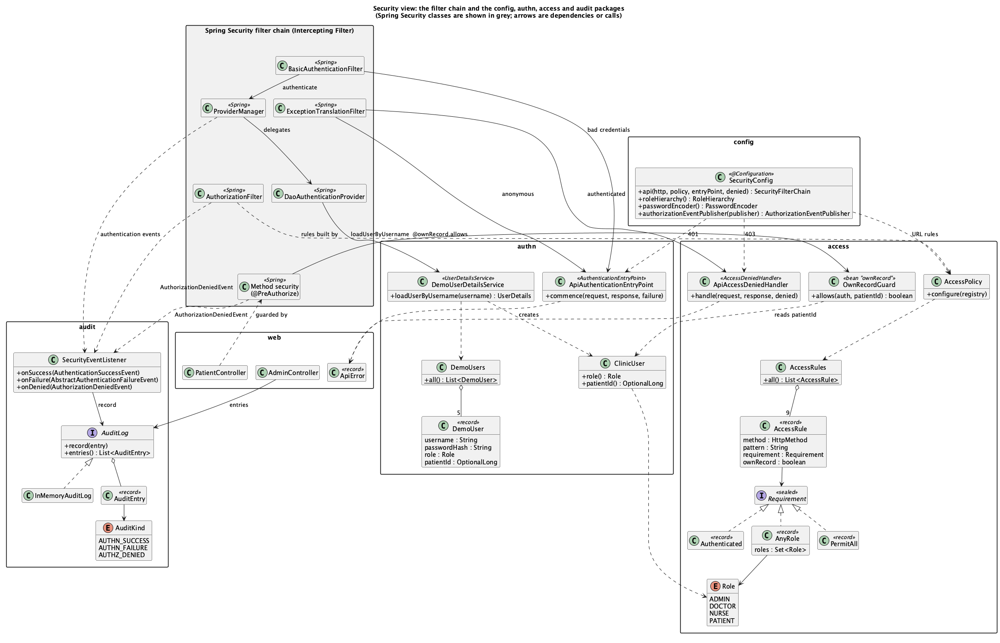

# 5. Security view

This view shows the classes that carry out the security tactics and how they connect to the Spring
Security filter chain. Classes from Spring Security are grey and drawn as one group, the chain. Our
classes are grouped by package. The `clinic` package is left out because it holds only domain data
and no security logic.

The PlantUML source is `uml/class/security-view.puml`, and a text outline of the diagram is in
`uml/class/security-view.utxt`.

How to read it: a request enters at `BasicAuthenticationFilter` (top left) and meets the `authn`
classes first. It then passes `AuthorizationFilter`, whose rules come from the `access` table, and
for the two patient read services it also passes method security, which calls `OwnRecordGuard`.
Every rejection leaves the chain through one of two classes, `ApiAuthenticationEntryPoint` (401)
or `ApiAccessDeniedHandler` (403), and both write the same `ApiError` body. Every decision is
published as an event and arrives at `SecurityEventListener` in `audit`. `SecurityConfig` connects
all of this and contains no behaviour of its own.

## Element catalog

**`config` package.** `SecurityConfig` is the only class that wires the chain. It builds the single
`SecurityFilterChain` (HTTP Basic, stateless sessions, CSRF off, the 401 entry point and the 403
handler) and delegates the URL rules to `AccessPolicy`. It also declares the shared security beans:
the role hierarchy `ROLE_ADMIN > ROLE_DOCTOR > ROLE_NURSE`, which both URL rules and method security
honour; the delegating `PasswordEncoder`, which selects BCrypt from the `{bcrypt}` prefix of a stored
hash; and the `AuthorizationEventPublisher`, without which Spring Security would not publish
authorization denials and the audit log would miss them. `@EnableMethodSecurity` on the class turns
on the `@PreAuthorize` checks. The class is part of the frozen contract.

**`access` package (Authorize Actors, Limit Access).** `AccessRules` holds the ordered service
table as immutable `AccessRule` records. Each row supplies its HTTP method, path pattern,
`Requirement` (`PermitAll`, `Authenticated`, or `AnyRole`), and own-record marker. `Role` names
the four actor types; the staff hierarchy is supplied by `config.SecurityConfig`. `AccessPolicy`
turns the table into URL authorization rules, permits ERROR dispatch first, and denies unlisted
requests last. `OwnRecordGuard`, named `ownRecord`, is the per-actor check called by the
two patient read methods' `@PreAuthorize` annotations: patients must match their principal's
patient ID, while staff already admitted by URL authorization may read any patient.
`ApiAccessDeniedHandler` writes a consistent JSON 403 response using `web.ApiError` for an
authenticated caller who fails either check. The configured Spring authorization event publisher
reports both kinds of denial for the audit listener.

**`authn` package (Identify Actors, Authenticate Actors).** These classes are the application's
side of HTTP Basic authentication; the filter, the authentication manager and the provider that call
them come from Spring Security. `DemoUser` is a record for one seeded user: username, `{bcrypt}`
password hash, role, and, for a patient, the patient id. `DemoUsers` holds the five seeded users;
plaintext passwords never appear in the application code. `DemoUserDetailsService` is the
`UserDetailsService` that Spring's `DaoAuthenticationProvider` consults on every request that
carries Basic credentials: it returns a new `ClinicUser` for a known name and throws only
`UsernameNotFoundException` for an unknown one, so that Spring can report an unknown user exactly
like a wrong password. `ClinicUser` extends Spring's `User` and is the authenticated principal;
besides the single `ROLE_*` authority it carries the role and patient id, which the own-record rule
reads during authorization without a second lookup. `ApiAuthenticationEntryPoint` is the
`AuthenticationEntryPoint` installed on both HTTP Basic and exception handling; it writes every 401
with the challenge `WWW-Authenticate: Basic realm="clinic"` and the JSON body
`{"status":401,"error":"Unauthorized","path":...}` (built by the shared `web.ApiError` record), and
never reveals why authentication failed.

**`audit` package (Audit).** `SecurityEventListener` subscribes to three Spring Security events:
`AuthenticationSuccessEvent`, `AbstractAuthenticationFailureEvent` and `AuthorizationDeniedEvent`.
It turns each into an `AuditEntry` that holds the time, an `AuditKind` (`AUTHN_SUCCESS`,
`AUTHN_FAILURE`, `AUTHZ_DENIED`), the username (`anonymous` for a caller without credentials), the
HTTP method and path, and a detail: the exception name for a failed login, or the required roles,
`denyAll`, `authenticated`, or the guarded method name for a denial. The listener appends the entry
to the `AuditLog` and writes it to the application log at INFO. `InMemoryAuditLog` is the only
`AuditLog`. It is synchronized for concurrent requests and keeps the newest 1000 entries, so memory
stays bounded. Because the listener reacts to events, no controller or filter of ours calls the log
directly.

**`web` package.** The controllers are the services of the access table and contain no security
checks of their own, with one exception. `PatientController.record` and `appointments` carry
`@PreAuthorize("@ownRecord.allows(authentication, #id)")`, the hook for the per-actor rule.
`AdminController` exposes the user list (usernames and roles only, never password hashes) and the
audit log. `MeController` reports the caller's own username, role and patient id. `PublicController`
is the one service that needs no login. `ApiError` is the shared `{"status","error","path"}` body
that both the 401 and the 403 responses use, so a rejection never reveals more than its status and
path.

**`clinic` package (not drawn).** `ClinicRepository` holds the patients, records, appointments,
vitals and prescriptions in memory. It throws `PatientNotFoundException` (mapped to 404) for an
unknown id. It is reached only after authorization has succeeded, which is why a patient sees 403,
never 404, for another patient's id.
