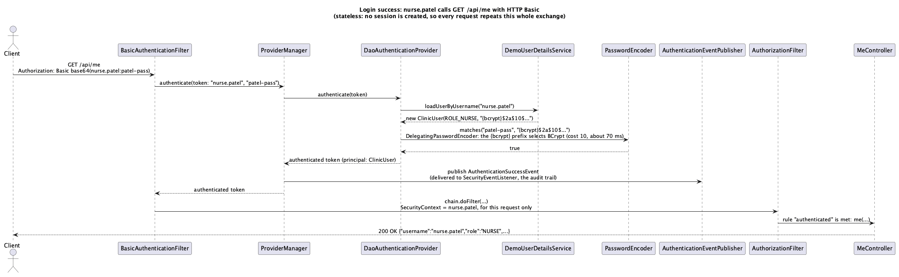
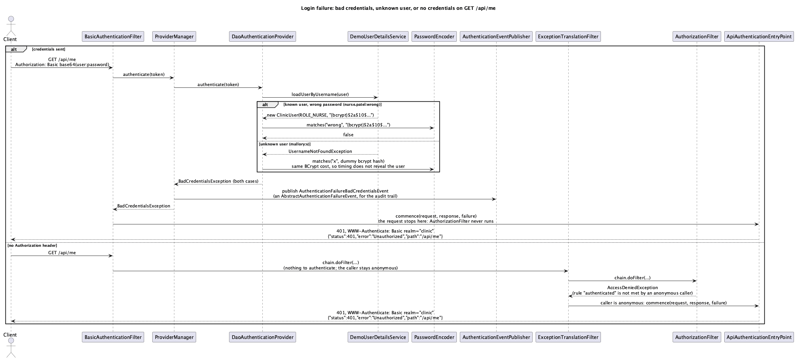

<!-- Owner: Godson (slice 1) for the login diagrams; Kobe (slice 2) for the request diagrams -->
<!--
What belongs in this section, each diagram with a short narrative:
- uml/sequence/login-success.puml (slice 1): BasicAuthenticationFilter -> ProviderManager -> DaoAuthenticationProvider ->
  DemoUserDetailsService -> PasswordEncoder -> AuthenticationSuccessEvent -> AuthorizationFilter -> controller.
- uml/sequence/login-failure.puml (slice 1): the same chain ending in BadCredentialsException ->
  AbstractAuthenticationFailureEvent -> ApiAuthenticationEntryPoint -> 401.
- uml/sequence/authorized-request.puml (slice 2): nurse -> /api/patients/1/record through the role rule and OwnRecordGuard -> 200.
- uml/sequence/forbidden-request.puml (slice 2): bob -> /api/patients/1/record, OwnRecordGuard denies ->
  AuthorizationDeniedEvent -> ApiAccessDeniedHandler -> 403; side note on the pure role denial.
-->

# 6. Sequence diagrams

## Login success and login failure

<!-- Slice 1 (Godson) writes this subsection. -->

Both diagrams follow one request to `GET /api/me`, the service that only asks for an authenticated
caller. Under stateless HTTP Basic there is no separate login step: each request carries the
username and password, so "login" here means the authentication that happens at the start of every
request. The PlantUML sources and text renderings are next to the images in `uml/sequence/`.

### Login success

1. The client sends `GET /api/me` with `Authorization: Basic` and the Base64 of
   `nurse.patel:patel-pass`. `BasicAuthenticationFilter` decodes the header into a username and
   password token. This is where the actor is identified, by username.
2. The filter passes the token to `ProviderManager`, which hands it to `DaoAuthenticationProvider`.
3. The provider asks `DemoUserDetailsService` for `nurse.patel`. The service builds a new
   `ClinicUser` holding the stored `{bcrypt}` hash, the role `NURSE`, and no patient id. It is a new
   object on every call because Spring erases the password from the principal after a successful
   check.
4. The provider calls `PasswordEncoder.matches` with the presented password and the stored hash.
   The delegating encoder sees the `{bcrypt}` prefix and runs BCrypt, which takes about 70 to 80 ms.
   This comparison is the authentication decision: `true` means the caller is who it claims to be.
5. The provider returns an authenticated token whose principal is the `ClinicUser`.
   `ProviderManager` publishes an `AuthenticationSuccessEvent`, which the audit listener
   (`SecurityEventListener`) receives.
6. `BasicAuthenticationFilter` stores the authentication in the security context for this request
   only and continues down the chain. `AuthorizationFilter` finds that the rule for `/api/me`
   requires only an authenticated caller, so the request reaches `MeController`, which answers
   `200 OK`.

Nothing is kept afterwards. The next request from the same client repeats all six steps.

Step 6 describes the finished system, with the URL rules and the `/api/me` service in place. Until
those are merged, the authorization scaffold denies every URL except the public one, so on the
authentication work alone this same request is authenticated (steps 1 to 5 happen exactly as shown)
and is then refused at `AuthorizationFilter`.

### Login failure

The diagram has two outer cases.

**Credentials sent but wrong.** The first four messages are the same as in the success case. The
difference is inside `DaoAuthenticationProvider`, shown as an inner choice:

- *Known user, wrong password* (`nurse.patel:wrong`): the user service returns a `ClinicUser`, and
  `PasswordEncoder.matches` returns `false`.
- *Unknown user* (`mallory:x`): the user service throws `UsernameNotFoundException`. The provider
  still runs a BCrypt comparison against a dummy hash, so an unknown name takes about as long as a
  wrong password.

Both cases leave the provider as the same `BadCredentialsException`; this is where the failure is
decided, and where the two cases stop being distinguishable. `ProviderManager` publishes an
`AuthenticationFailureBadCredentialsEvent` (a subclass of `AbstractAuthenticationFailureEvent`) for
the audit listener and rethrows. `BasicAuthenticationFilter` catches the exception and calls
`ApiAuthenticationEntryPoint.commence`, which answers `401` with
`WWW-Authenticate: Basic realm="clinic"` and `{"status":401,"error":"Unauthorized","path":"/api/me"}`.
The request never reaches `AuthorizationFilter` or a controller, which is why bad credentials get a
401 even on the public URL.

**No credentials.** With no `Authorization` header, `BasicAuthenticationFilter` has nothing to check
and lets the request continue as anonymous. `ExceptionTranslationFilter` passes it on to
`AuthorizationFilter`, which refuses it because an anonymous caller does not meet the rule
"authenticated", and throws `AccessDeniedException`. `ExceptionTranslationFilter` catches it, sees
that the caller is anonymous, and sends it to the same entry point instead of the 403 handler. The
caller gets the same 401 and challenge as in the first case. An anonymous request to a URL that
nobody may call, such as `/api/nothing`, also gets 401 this way: the caller is asked who they are
before being told what they may not do.

## Authorized request and forbidden request

<!-- Slice 2 (Kobe) writes this subsection. -->
