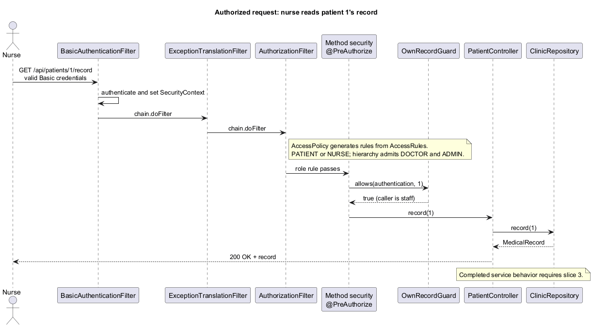
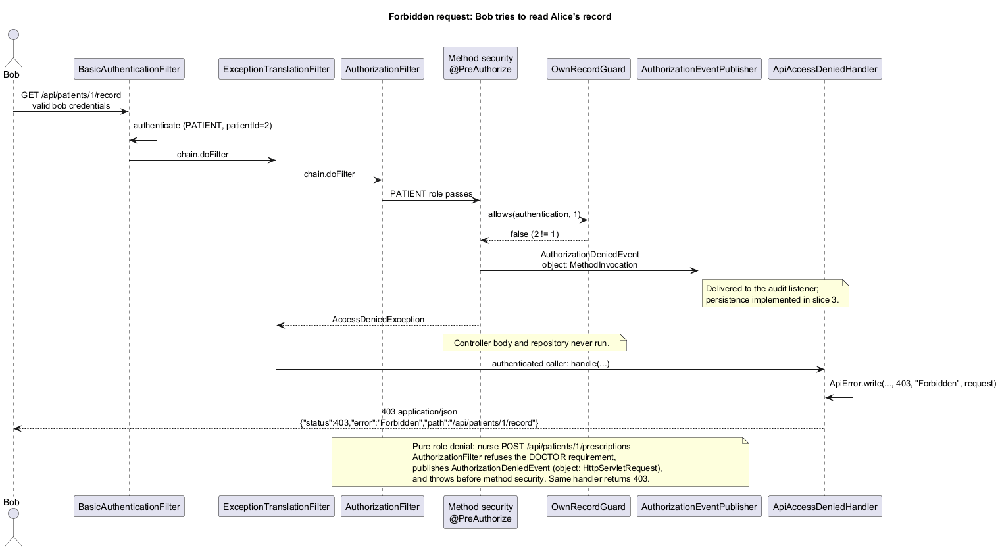

<!-- Owner: Godson (slice 1) for the login diagrams; Kobe (slice 2) for the request diagrams -->
<!--
What belongs in this section, each diagram with a short narrative:
- uml/sequence/login-success.puml (slice 1): BasicAuthenticationFilter -> ProviderManager -> DaoAuthenticationProvider ->
  DemoUserDetailsService -> PasswordEncoder -> AuthenticationSuccessEvent -> AuthorizationFilter -> controller.
- uml/sequence/login-failure.puml (slice 1): the same chain ending in BadCredentialsException ->
  AbstractAuthenticationFailureEvent -> ApiAuthenticationEntryPoint -> 401.
- uml/sequence/authorized-request.puml (slice 2): nurse -> /api/patients/1/record through the role rule and OwnRecordGuard -> 200.
- uml/sequence/forbidden-request.puml (slice 2): bob -> /api/patients/1/record, OwnRecordGuard denies ->
  AuthorizationDeniedEvent -> ApiAccessDeniedHandler -> 403; side note on the pure role denial.
-->

# 6. Sequence diagrams

## Login success and login failure

<!-- Slice 1 (Godson) writes this subsection. -->

## Authorized request and forbidden request

<!-- Slice 2 (Kobe) writes this subsection. -->

### Authorized request

A nurse requests `GET /api/patients/1/record` with valid Basic credentials. Authentication
establishes the `ClinicUser` before authorization. `AuthorizationFilter` checks the rule generated
by `AccessPolicy` from `AccessRules`: PATIENT or NURSE is required, with DOCTOR and ADMIN also
admitted through the staff hierarchy. Method security then calls `OwnRecordGuard`. The nurse
does not hold `ROLE_PATIENT`, so the guard allows the call. Only then does the controller read
the repository and return the record with 200.

The diagram shows the completed service path. On the Step 0 baseline, the authorization checks
are implemented by this slice but the controller and repository bodies await slice 3. Successful
service responses belong to `AccessMatrixTest` during integration, rather than this slice's tests.

### Forbidden request

Bob requests Alice's record at `/api/patients/1/record`. His PATIENT role passes URL authorization,
but method security calls `OwnRecordGuard` and finds that his principal's patient ID is 2.
The check returns false, publishes an `AuthorizationDeniedEvent` whose object is a
`MethodInvocation`, and throws an access-denied exception. The controller body and repository
are never called. `ExceptionTranslationFilter` recognizes an authenticated caller and invokes
`ApiAccessDeniedHandler`, returning JSON with status 403 and the requested path.

The side note shows a pure role denial: a nurse posting a prescription is stopped by
`AuthorizationFilter`, which publishes a denial event whose object is the HTTP request.
Method security is never reached, and the same handler returns 403. An anonymous caller uses
slice 1's 401 entry point instead. The audit listener receives these events once slice 3 is
implemented; the event publisher is already wired in the shared configuration.
